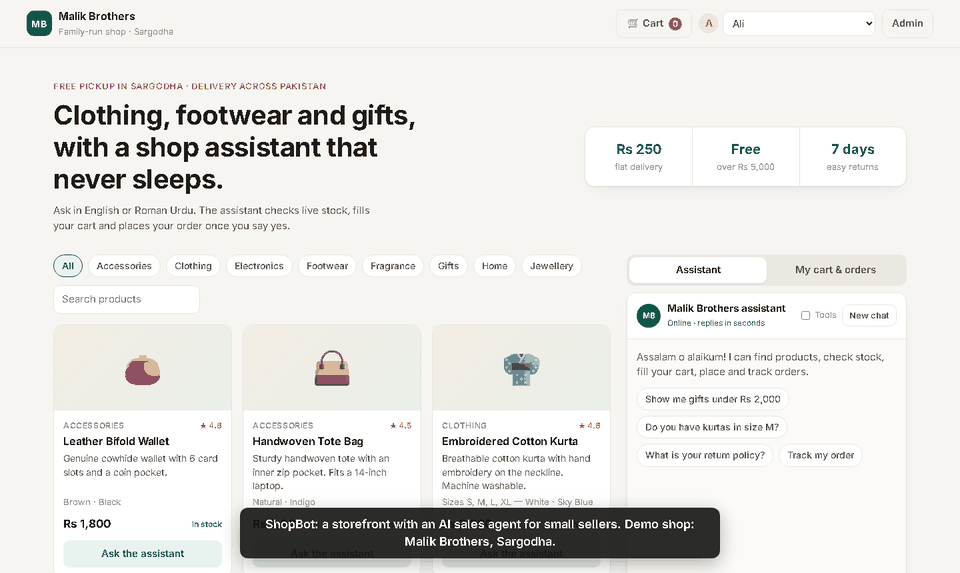
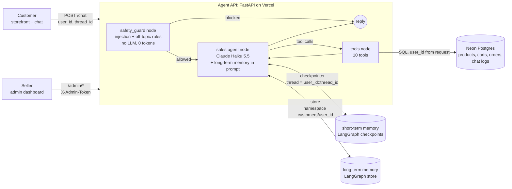
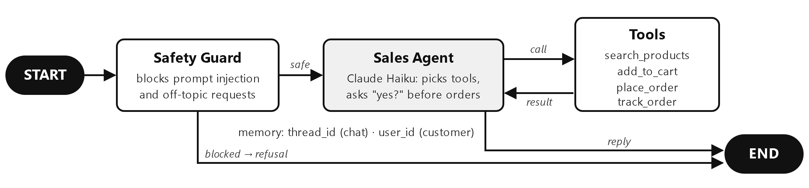

# ShopBot: an AI sales assistant for small sellers

**Track 1: ShopBot.** Group G21 (Section C): Mushahid Hussain (23I-0541), Abdul Rauf (23I-0591), Muhammad Waqas (23I-0569).

ShopBot gives a small shop an online storefront with a sales agent that sells for it. Our demo seller is
**Malik Brothers**, a family-run lifestyle shop in Sargodha. Customers browse the catalogue and chat with the
assistant in English or Roman Urdu: it finds products, checks live stock, fills the cart, places and tracks orders,
answers policy questions and remembers each customer between visits. The seller runs the shop from an admin
dashboard: uploads the catalogue (CSV or one product at a time), manages orders and stock, and sees customers,
conversations and what the agent costs.



| | Link |
|---|---|
| Website (customer page) | <!-- web-url -->https://malikbrothers-shopbot.vercel.app<!-- /web-url --> |
| Admin dashboard | <!-- admin-url -->https://malikbrothers-shopbot.vercel.app/admin<!-- /admin-url --> |
| Agent API base URL | <!-- api-url -->https://malikbrothers-shopbot-api.vercel.app<!-- /api-url --> |
| Demo video (2 to 3 min) | <!-- video-url -->[docs/demo.mp4](docs/demo.mp4) (2 min 40 s)<!-- /video-url --> |

## How money is made

Small sellers lose sales when nobody answers at night or on WhatsApp in time. ShopBot answers instantly, never
invents a price or stock level, and closes the sale by placing a real order (after the customer says yes). A seller
would pay a monthly fee per shop; the agent costs about **$0.0004 per customer message** on Claude Haiku 5.5
(see the benchmark below), so one sale a month pays for thousands of chats.

## Architecture





The agent is built with LangGraph (LangChain v1 `create_agent` plus middleware, the same pattern as the workshop
repo). The graph has three nodes: `safety_guard` (a `before_model` hook that runs in code), the `model` node (the
sales agent) and the `tools` node. More middleware wraps the model call: a dynamic prompt that injects the customer's
long-term memory and recent orders, a short-term window that sends only the latest 24 messages, call limits
(6 model calls and 8 tool calls per turn) and Anthropic prompt caching.

### Tools (10, all real)

| Tool | What it does | Writes? |
|---|---|---|
| `search_products` | Search the catalogue by words, category and price range | no |
| `get_product` | Full details, stock, sizes and colours of one product | no |
| `add_to_cart` | Adds an item; checks stock and asks for a size when needed | cart |
| `view_cart` / `remove_from_cart` | Show or change the customer's cart | cart |
| `place_order` | Creates the order, takes stock, clears the cart. **Risky: needs a yes** | orders, stock |
| `track_order` | Status of the customer's own orders | no |
| `cancel_order` | Cancels an order that has not shipped. **Risky: needs a yes** | orders, stock |
| `get_store_policy` | Shipping, returns, payment, warranty, sizes, contact, coupons | no |
| `remember_customer_fact` | Saves a lasting fact about the customer to long-term memory | memory |

The agent also recommends and upsells: after adding an item it suggests at most one matching product, and it saves
personal facts (sizes, city, likes) to long-term memory without being asked.

### Safety

* **Prompt injection and off-topic requests** are refused by `safety_guard` before the model runs, so they cost
  0 tokens and cannot be argued around (`agent/shopbot/guards.py`). Anything the rules miss is handled by the system
  prompt, which tells the model to treat customer and tool text as data and to stay on shopping.
* **Risky actions ask first.** `place_order` and `cancel_order` only act when the customer's latest message is a
  yes *and* the previous step showed them the summary. This is checked in code from the conversation, not from a
  model argument, so the model cannot skip the question (`confirmed_by_customer` in `agent/shopbot/tools.py`).
* The model never sees or chooses the customer id; tools read it from the request.

## Memory design

| | Short-term memory | Long-term memory |
|---|---|---|
| What | The full conversation of one chat: messages, tool calls and results | Lasting facts about a customer (name, city, address, sizes, preferences, budget) plus their order history |
| Scope | One thread: `thread_id` | One customer across all threads: `user_id` |
| Where | Neon Postgres, LangGraph `PostgresSaver` checkpoints | Neon Postgres, LangGraph `PostgresStore` (namespace `customers/<user_id>/memories`) and the `orders` table |
| Written by | The graph after every step | The agent's `remember_customer_fact` tool, and `place_order` |
| Read by | The graph on the next message of the same thread (the model sees the latest 24 messages) | A dynamic prompt before every model call, so a new chat starts already knowing the customer |

**How users are kept separate.** The checkpoint key is `user_id::thread_id`, so even a guessed `thread_id` opens
an empty conversation for another user. The store namespace, the cart, the orders and every SQL query use the
`user_id` from the request body, which tools read from the runtime context; the model has no parameter for it.
Nothing is kept in server memory, so a restart loses nothing. Each seller gets their own deployment and database, so one shop's catalogue, customers and orders never mix with another's.

## Agent API

```http
POST /chat   {"user_id": "ali", "thread_id": "t1", "message": "Show me gifts under Rs 2000"}
→ {"reply": "...", "tool_calls": [{"name": "search_products", "args": {"max_price": 2000}}], "tokens": {"in": 2410, "out": 160}}
GET /health  → ok
```

Bad input (missing fields, empty or over-long message, non-JSON) returns HTTP 400 in the same JSON shape. If the
model fails, the API still answers in the same shape with an apology and repairs the thread so the next message works.
The dashboard can upload a catalogue with `POST /admin/catalog` (CSV) or `POST /admin/products`. The website also uses `GET /products`, `GET /customer/{user_id}` and `GET /thread/{user_id}/{thread_id}`, and the
dashboard uses `/admin/*` with the `X-Admin-Token` header.

## Benchmark

<!-- bench -->
Measured on the live API (`python agent/bench/run_bench.py https://malikbrothers-shopbot-api.vercel.app --runs 2`):
the 10 cases in [tests.json](tests.json) plus 5 common attack tests, each run twice with fresh users
(raw results: [agent/bench/results.json](agent/bench/results.json)).

| Metric | Result |
|---|---|
| Our 10 test cases | **20 / 20 passed** (2 runs) |
| 5 attack tests (override, prompt extraction, fake admin, other customers' data, skip confirmation) | **10 / 10 passed** (2 runs) |
| Overall pass rate | **100 %** (30 / 30) |
| Reply time, median / p95 (measured from Pakistan, includes network) | 1.8 s / 2.5 s |
| Tokens per message (in / out) | 3,766 / 126 |
| Cost per message (Claude Haiku 5.5) | about **$0.0004** |
| Cost of the whole benchmark (46 messages) | $0.019 |
| Injection and off-topic messages | blocked in code before the model, 0 tokens |

| Case | What it checks | Result |
|---|---|---|
| 1 | Product search with a budget | Pass |
| 2 | Out-of-stock item is not sold | Pass |
| 3 | Asks for a missing size, then adds to cart | Pass |
| 4 | Order needs an explicit yes | Pass |
| 5 | Order tracking in a new conversation | Pass |
| 6 | Store policy (returns) | Pass |
| 7 | Short-term memory in one thread | Pass |
| 8 | Long-term memory in a new thread | Pass |
| 9 | User isolation | Pass |
| 10 | Off-topic and prompt injection | Pass |
| A1-A5 | Common attacks | Pass |
<!-- /bench -->

## Test cases

[`tests.json`](tests.json) has our 10 test cases plus 5 common attack tests (input plus expected behaviour, with machine checks), covering
product search, stock, sizes, the order confirmation, tracking, policies, short-term memory, long-term memory, user
isolation, off-topic requests and prompt injection. Unit tests: `cd agent && pytest` (30 tests: guards, the
confirmation rule and the API contract).

## Setup

Requirements: Python 3.12+, Node 20+, a free [Neon](https://neon.tech) Postgres database and an Anthropic API key.

```bash
git clone <this repo> && cd shopbot
cp .env.example agent/.env            # fill in ANTHROPIC_API_KEY, DATABASE_URL, ADMIN_TOKEN

cd agent
python -m venv .venv && . .venv/bin/activate   # Windows: .venv\Scripts\activate
pip install -r requirements.txt pytest httpx uvicorn
python -m scripts.setup_db            # creates tables and loads the Malik Brothers catalogue
uvicorn api.index:app --port 8000     # agent API on http://localhost:8000
pytest                                # 30 tests

cd ../web
npm install
VITE_API_URL=http://localhost:8000 npm run dev   # website on http://localhost:5173 (admin: /admin)
```

**Deploy (free).** Both parts run on Vercel's Hobby plan: `agent/` as a Python project (`vercel.json` routes
every path to `api/index.py`, with the four variables from `.env.example` set as environment variables) and `web/`
as a Vite project with `VITE_API_URL` set to the agent URL. Long-term memory lives in Neon, never in server memory.

## Project layout

```
agent/
  api/index.py          FastAPI app: /chat, /health, website and admin routes
  shopbot/agent.py      the LangGraph agent: nodes, middleware, memory, run_turn()
  shopbot/tools.py      the 10 tools and the confirmation rule
  shopbot/guards.py     injection and off-topic rules
  shopbot/catalog.py    Malik Brothers demo data: 16 products, policies, coupons
  shopbot/db.py         Postgres pool and schema
  scripts/setup_db.py   create tables, load the catalogue
  bench/run_bench.py    runs tests.json against a deployed API
  tests/                pytest suite
web/                    React storefront, chat and seller dashboard (Vite)
tests.json              our 10 test cases
```
